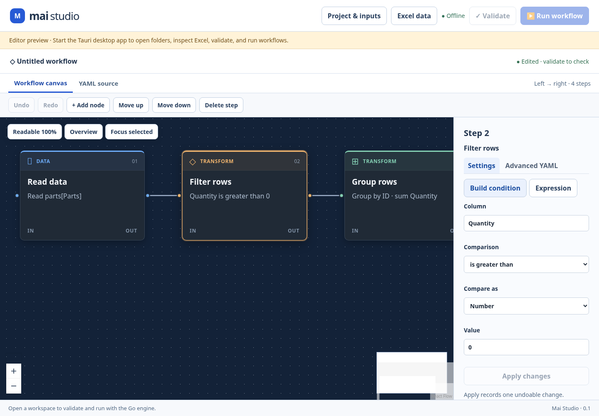

# Mai Studio user guide



Mai Studio edits YAML workflows and runs them locally with the production Go
engine. This milestone supports offline Excel fixtures. SQL and external REST
connections are disabled.

## Start and open a workspace

For Windows prerequisites, PowerShell commands, and running the HTTP microservice,
see the [README getting-started instructions](../README.md).

From the repository root:

```sh
cd apps/studio
npm ci
npm run desktop:dev
```

Install the native prerequisites listed in the
[development guide](MAI_STUDIO_DEVELOPMENT.md) first. `npm run dev` opens an editor
preview in a browser; folder access, saving, validation, workbook inspection, and
execution require the Tauri desktop app.

Open **Project & inputs**, then choose **Open workspace** and select a local
project folder. All workflow and workbook paths are relative to that folder. For the bundled example, select the
repository root. Use synthetic inputs while developing; keep private workbooks,
credentials, and generated runs out of source control.

## Open, create, and save workflows

The **Open a workflow…** list discovers `.yaml` and `.yml` files recursively inside
the workspace's `workflows/` directory. It skips symlinks. You can also enter a
workspace-relative YAML file in **Open path** and choose
**Open workflow path**, including files outside `workflows/`. The initial document
is a built-in parts-summary example. Workflow controls and input bindings are in
**Project & inputs**.

To create a workflow, edit that document or replace its YAML, enter a new
workspace-relative **Save path**, and choose **Save workflow**. For example, use
`workflows/summary.yaml`; create the `workflows` directory outside Studio first if
it does not exist. Parent directories must already exist. Saving to a different,
unused path creates a copy. An existing destination cannot be overwritten this
way. `Ctrl/Cmd+S` saves to the current Save path.

A dot and **Unsaved** mark changes since the last successful save or load.
Switching workflows or workspaces, or closing the native window, asks whether to
discard unsaved work; choose **Keep editing** to retain it. Save before closing.
There is no autosave or recovery store, and input bindings are session settings rather than
part of the saved YAML.

A save checks whether the file changed on disk since it was opened or last saved.
A conflict leaves your editor contents intact and reports an error in the status
bar. Preserve those contents in a new, unused Save path, then reopen the original
to compare the external changes. Studio has no merge dialog or force-overwrite
control. Discovery is refreshed when opening a workspace; reopen the workspace if
files added externally do not appear.

## Edit and inspect steps

The canvas opens with the project sidebar and Excel panel hidden, leaving space
for the workflow. **Project & inputs** and **Excel data** toggle those panels.
Nodes show their operation, category, argument summary, and execution number in a
horizontal flow; branch connections reflect the YAML execution structure.

Use **Readable 100%** to return to the normal node size, **Overview** to fit the
workflow, and **Focus selected** to bring a selected node into view. Panning and
zooming change the view, not execution order.

Choose **+ Add node** to open the searchable node library. Search by operation,
title, or description, then choose a node to append it to the workflow. Available
operations include reading data, filtering, calculating/selecting/renaming
columns, sorting, grouping, joining, and saving a table. The new node is selected
so you can configure it. Defaults are starting points; fill in the required
settings and validate before running.

Select a top-level step to open its inspector. **Settings** is the default view
and provides operation-specific fields: conditions, table names, column rows,
sort/group columns, and join options where supported. Comma-separated column
fields accept column names, and **Add row** adds a column mapping or calculation.
**Apply changes** records the draft as one undoable edit; **Discard changes**
returns to the last applied argument. Until you apply or discard
a draft, Studio blocks Save, Run, source navigation, and other step edits.

Use **Advanced YAML** for argument options or shapes the guided form cannot
represent. Existing options outside the form fields are preserved. The inspector
offers a fallback when guided settings are unavailable. Use **YAML source** for
nested steps, unsupported step forms, changing operation names, and complete
workflow definitions. YAML remains the executable source.

Select a top-level step and use **Delete step**, **Move up**, or **Move down** to
change execution order. Moving a compound step moves its branches with it. Canvas
nodes cannot be dragged into a new execution order or connected manually; the
visible ports describe the current flow. Source errors should be corrected in
**YAML source**.

**Undo** and **Redo** cover source edits and applied step changes. Loading a
document resets this history. Outside text fields, use `Ctrl/Cmd+Z` to undo and
`Ctrl/Cmd+Shift+Z` or `Ctrl/Cmd+Y` to redo. Other shortcuts outside text fields are
`Alt+Insert` to open the node library, `Delete`/`Backspace` to delete the
selected top-level step, and `Alt+Up`/`Alt+Down` to move it. Text fields retain their normal text shortcuts.

## Validate, bind inputs, and run

1. Choose **Validate** to check the current editor YAML with the Go parser. Errors
   appear in the status bar. Validation populates the declared input fields.
2. Open **Project & inputs**. Under **Input files**, bind each input name to an
   existing workbook inside the workspace. For the initial parts-summary example, bind `parts` to
   `examples/parts.xlsx`. Validate again after changing input declarations.
3. Choose **Run workflow**. The runner executes the current editor contents, so
   saving is a separate action. External SQL/REST operations cannot run offline.
4. Open **Excel data** to inspect the generated workbook. Choose an **Input** tab
   to inspect a bound workbook or **Output workbook** for the generated artifact.
   You can also enter a workbook path and choose **Inspect workbook**.
5. Use the sheet selector and **Previous**/**Next** to page through rows. Click a
   cell to read its complete value in the cell inspector; **Clear** dismisses it.
   **Expand data** gives the panel more space, **Dock panel** restores it, and
   **Close** returns the space to the canvas.

Outputs are written under `.studio/runs/` in the workspace. The output path and
SHA-256 identify the generated XLSX artifact. The preview reads actual workbook
cell values; styling, formula metadata, and full Excel visual fidelity are not
shown. Open the artifact in a spreadsheet application for those details.

Editing YAML or changing input bindings marks the displayed output stale. Run
again to refresh it. Changes to workbook files made outside Studio are not
tracked automatically; rerun after changing them.

## Workspace limits and troubleshooting

Workflow files must be UTF-8, at most 1 MiB, and end in `.yaml` or `.yml`. Absolute
paths, `..` traversal, and symlinks in workflow paths are rejected. Workbook paths
must resolve to files inside the selected workspace. A selected workspace grants
local file access to that folder; choose a folder you trust.

If native commands are disabled, start `npm run desktop:dev` rather than the
browser preview and open a workspace. If an input cannot be read, check that its
path is relative to the workspace and the file exists there. If the sidecar
cannot start, verify Go is on PATH or set `MAI_GO` to its executable. Missing
GTK/WebKit libraries or a missing desktop session prevent the Linux native host
from starting; see the development guide for dependencies.

Intermediate execution traces, cancellation controls, live connections, and the
Linux service package builder are planned. The disabled **Build Linux package**
control does not generate a deployment package.

For **Filter rows**, use **Build condition** to choose a column, comparison, and
text or number value. Studio writes the expression for you. Existing complex
conditions stay in Expression mode until you deliberately replace them.
